A WORM document archive app for the Frappe Framework

# docarchive

docarchive files business documents such as invoices, contracts and bank statements in a Frappe site. It is meant to copy each one, unchanged, into write-once (WORM) object storage for its retention period.

## Status

This version has the document model, the locks, the storage configuration, the upload API, the nightly archive run to Object Lock storage, legal holds, the deletion of expired documents, the archiving of e-mails and other correspondence, exports, the audit log and monitoring. Archiving is off until a System Manager enables it in Archive Settings. Until then, nothing leaves the site.

## No compliance promise

docarchive is a technical tool. It does not make you compliant with GoBD, the GDPR or any other law or standard, and it gives no legal or tax advice. Retention periods, procedures and documentation are your responsibility. Check them with your tax advisor or auditor.

## Features

**Archiving and WORM**
- [Object Lock per document](docs/archiving.md#object-lock-writes): every file is written once, with its own mode (GOVERNANCE or COMPLIANCE) and retain-until date, to one or more [storage targets](docs/storage.md#storage-targets).
- [Checksums](docs/concepts.md#how-it-works): SHA-256 at upload, checked again when archiving, after each write and on export.
- [Retention](docs/archiving.md#retention) per document type and own company, optionally [from the contract end](docs/archiving.md#contract-end-and-retention-extension).
- [Retention extension](docs/archiving.md#manual-extension), automatic for contracts and by hand, never shorter.
- [Nightly archive run](docs/archiving.md#archive-run) and [Archive now](docs/archiving.md#archive-now) with retain-until date and lock mode shown before confirming.

**Legal hold and deletion**
- [Legal hold](docs/legal-hold-and-deletion.md#legal-hold) at archiving or later, released only by Archive Admins.
- [Deletion of expired documents](docs/legal-hold-and-deletion.md#deleting-expired-documents) with a deletion log, and [early deletion](docs/legal-hold-and-deletion.md#early-deletion-governance-only) for GOVERNANCE copies.

**Documents**
- [Attachments](docs/concepts.md#how-it-works): annexes, e-invoice XML and proofs of service, archived and locked with the main file.
- [E-invoices](docs/e-invoices.md#e-invoices): XRechnung and ZUGFeRD data read into the document.
- [Counterparty panel](docs/host-apps.md#counterparty-panel), [triage](docs/host-apps.md#triage) of documents with missing fields, and an [upload API](docs/upload-api.md#upload-api).

**Correspondence**
- [E-mail capture](docs/correspondence.md#account-settings-and-modes) of the original `.eml` per account, off, manual or automatic, incoming and outgoing (rebuilt by Frappe or from the Sent folder via mailsync).
- [Archiving and discarding](docs/correspondence.md#archiving-and-discarding) mails from the Communication, with counterparty from its links; letters and faxes as uploads.
- [Viewer](docs/correspondence.md#viewer) for archived mails, [threads and gaps](docs/correspondence.md#threads-and-gaps), and [closing gaps with an `.eml` upload](docs/correspondence.md#closing-gaps-with-an-eml-upload).

**Export**
- [Export](docs/export.md#export) as ZIP packages with manifest, checksums and an offline viewer.

**Audit and monitoring**
- [Audit log](docs/audit-log.md#audit-log) of archive events, each entry stored under Object Lock and compared with the database every night.
- [Monitoring and completeness](docs/monitoring.md#monitoring-and-completeness): bell notifications for failed, overdue and incomplete archiving, and a completeness report.

**Integration**
- [Roles and permissions](docs/concepts.md#roles): Document Manager, Archive Admin, Document Integration, and host roles.
- [Host app hooks](docs/host-apps.md#host-app-hooks) for assignment, counterparties, file access and e-invoice extractors, and [commands](docs/commands.md#commands) for runs and checks.
- [Tools for AI agents](docs/ai-agents.md#ai-agents-mcp): list, read and assign open documents through the mcpserver app, without archiving.

## Screenshots

From the demo data of `bench --site <site> docarchive-demo` (see [Commands](docs/commands.md#commands)).

| | |
|---|---|
| <a href="docs/images/counterparty-panel.png">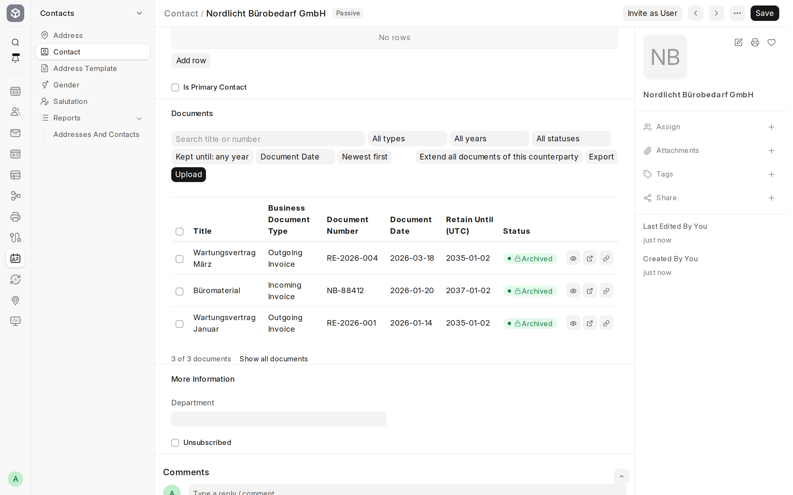</a><br>Counterparty panel: documents of a contact with filters, row actions and upload | <a href="docs/images/document-form.png">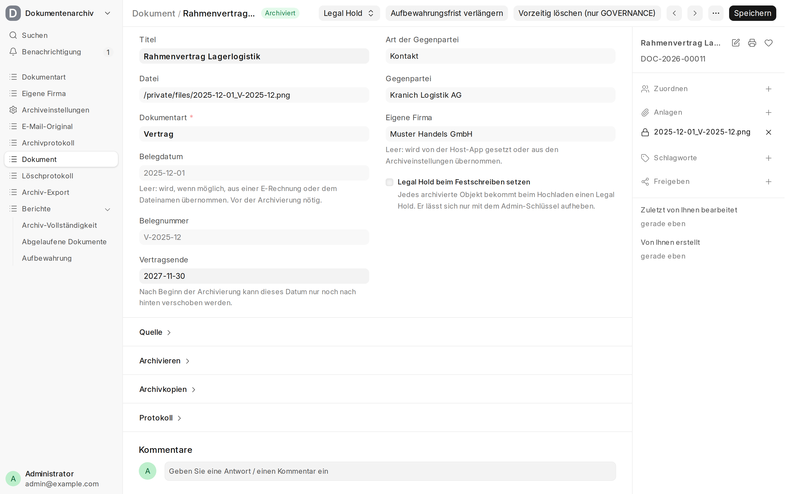</a><br>Business Document after archiving |
| <a href="docs/images/triage.png">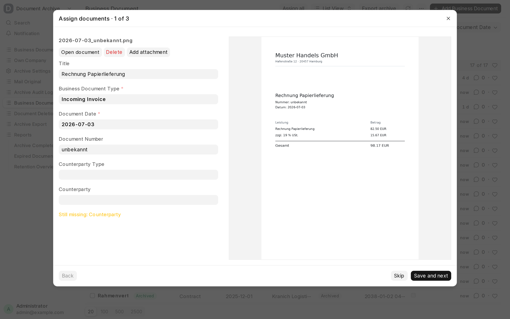</a><br>Triage: documents with missing fields, one by one | <a href="docs/images/archive-now.png">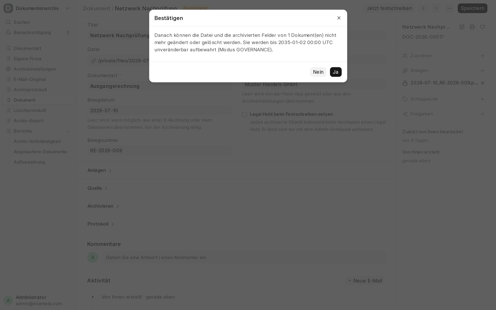</a><br>Archive now: confirmation with retain-until date and lock mode |
| <a href="docs/images/retention-overview.png">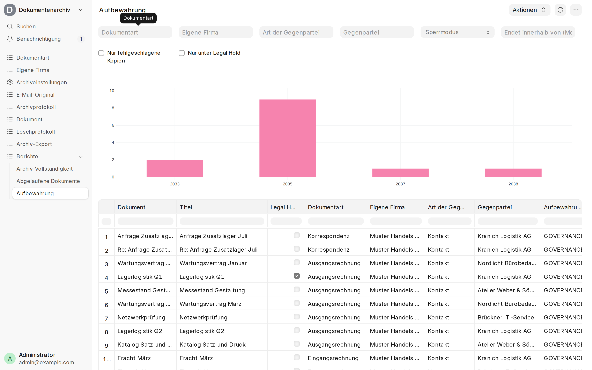</a><br>Retention Overview report | <a href="docs/images/legal-hold.png">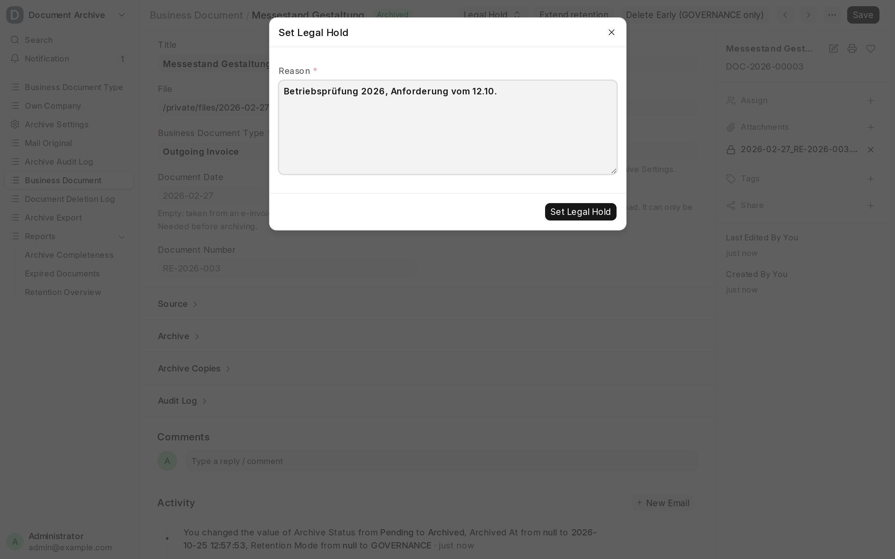</a><br>Setting a legal hold |
| <a href="docs/images/mail-viewer.png">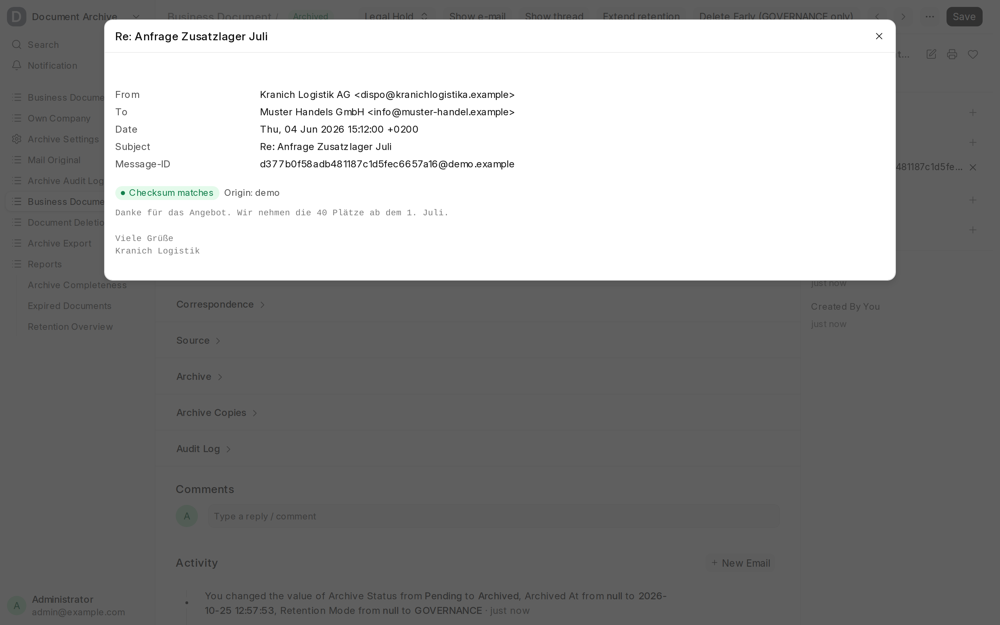</a><br>Archived e-mail in the viewer | <a href="docs/images/thread.png">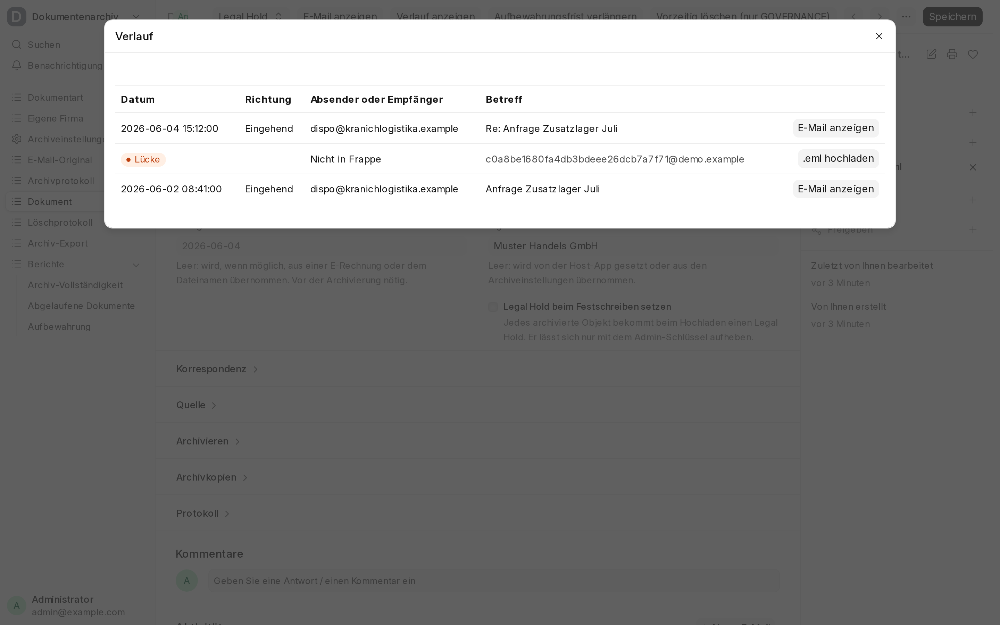</a><br>Mail thread with a gap |
| <a href="docs/images/audit-log.png">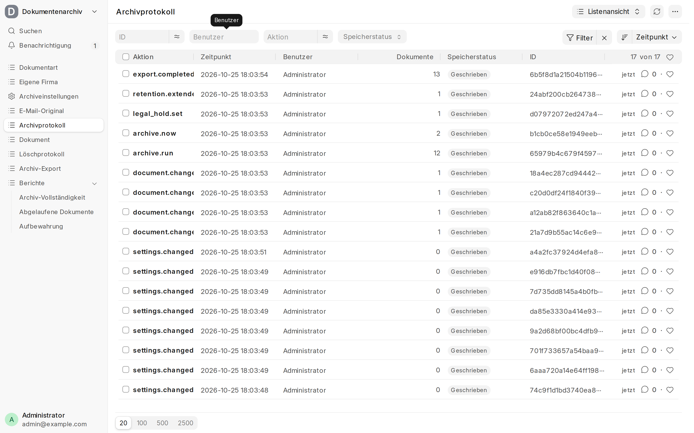</a><br>Archive Audit Log | <a href="docs/images/document-audit-log.png">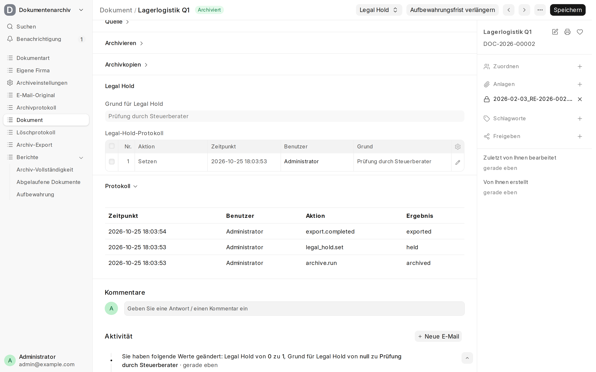</a><br>Audit log section on a document |
| <a href="docs/images/archive-completeness.png">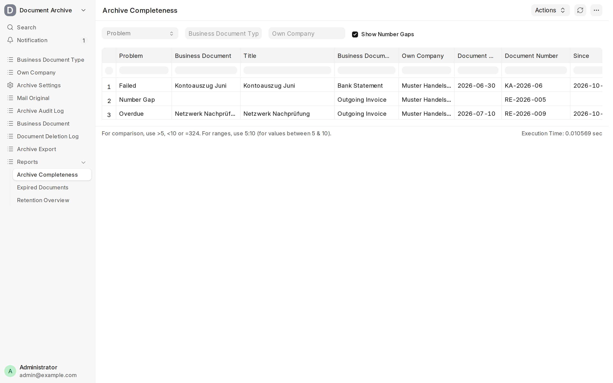</a><br>Archive Completeness report with a number gap | <a href="docs/images/export-viewer.png">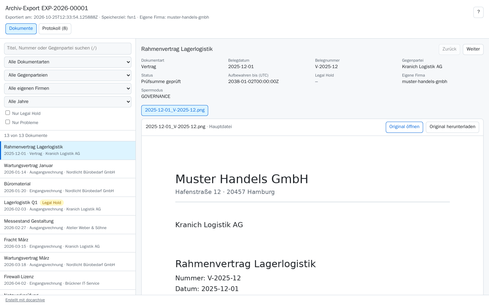</a><br>Offline export viewer |
| <a href="docs/images/export-viewer-audit-log.png">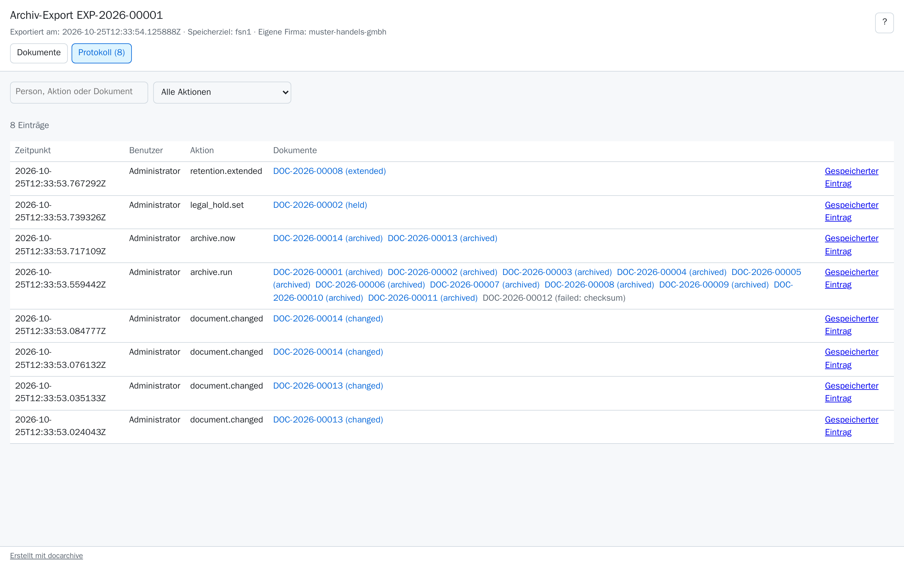</a><br>Audit log tab of the export viewer | <a href="docs/images/audit-entry.png">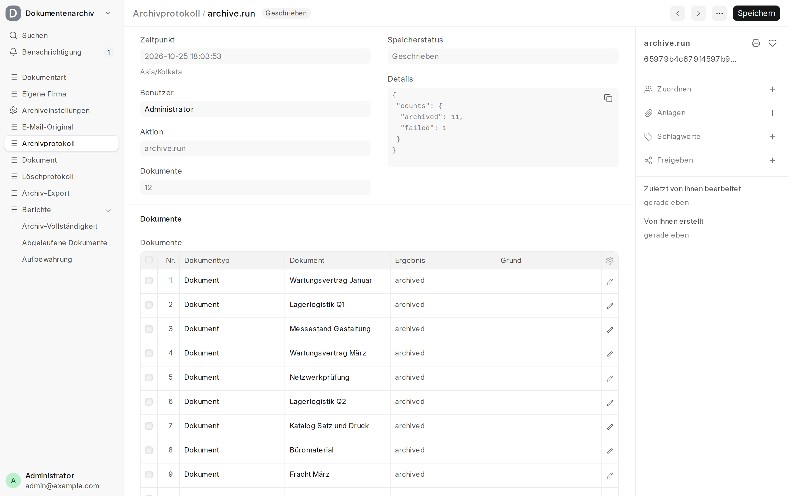</a><br>Audit entry of a nightly run |

## Documentation

- [How it works](docs/concepts.md): documents, attachments, checksums, Object Lock, retention, locking, roles
- [Storage targets](docs/storage.md) and [an example with Hetzner Object Storage](docs/hetzner-example.md)
- [Archiving](docs/archiving.md): nightly run, object keys, retention and its extension, archive now
- [Legal hold and deletion](docs/legal-hold-and-deletion.md)
- [Export](docs/export.md) with offline viewer
- [Audit log](docs/audit-log.md) and [monitoring](docs/monitoring.md)
- [Correspondence](docs/correspondence.md): e-mail capture, viewer, threads
- [E-invoices](docs/e-invoices.md)
- [Host apps](docs/host-apps.md): hooks, documents panel, triage, dashboard helpers
- [Upload API](docs/upload-api.md)
- [AI agents (MCP)](docs/ai-agents.md)
- [Commands](docs/commands.md), including demo data
- [Development](docs/development.md): tests

## Installation

```bash
bench get-app https://github.com/EffizienzAgent/s3storage --branch version-16
bench get-app https://github.com/EffizienzAgent/docarchive --branch version-16
bench --site <site> install-app docarchive
```

docarchive requires the [s3storage](https://github.com/EffizienzAgent/s3storage) app (v0.3.0 or later) for its S3 client and for storing large export files. s3storage keeps files on local disk until you configure its own bucket.

**Compatibility:** Frappe v16. The `version-16` branch always points to the latest release; tagged releases
and the changelog are on the [releases page](https://github.com/EffizienzAgent/docarchive/releases).

## Professional setup & support

Need help setting this up or integrating it into your Frappe stack? Write to oss@effizienzagent.de (English or German). German-speaking SMEs: see [mittelstandshub.de](https://mittelstandshub.de).

## License

MIT
